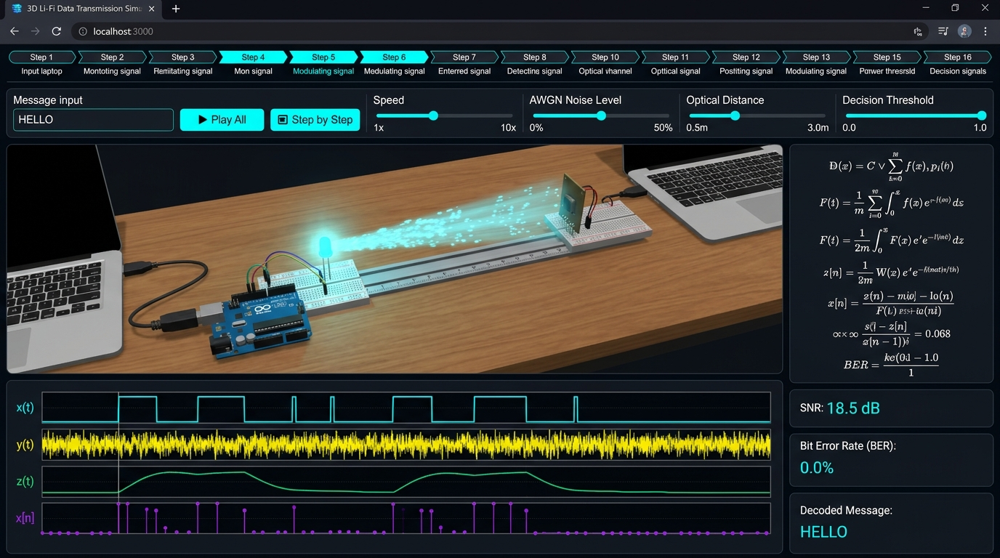
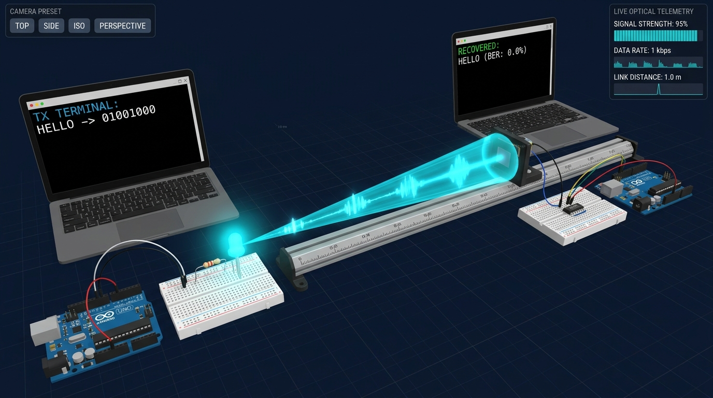
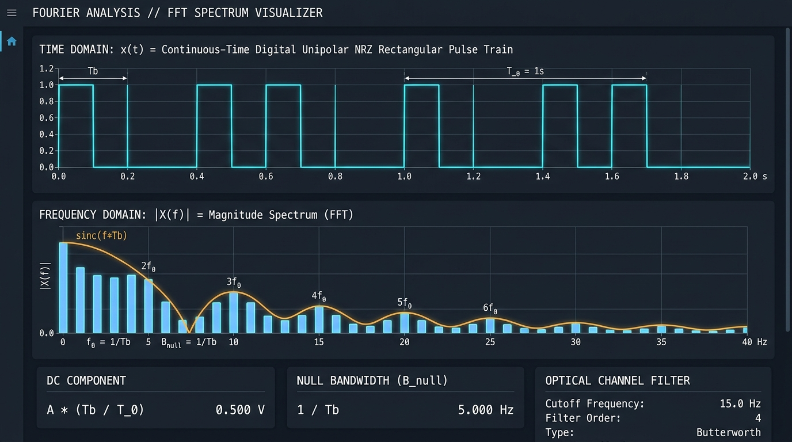

# 3D Li-Fi Data Transmission Simulator — Signals & Systems Lab

[](https://jamshedali.me)
[](https://jamshedali.me)
[](https://jamshedali.me)

> **Developed by [Jamshed Ali](https://jamshedali.me)**  
> An interactive, full-featured **3D Optical Wireless Communication (Li-Fi) & Digital Signal Processing (DSP) Simulator** designed for undergraduate **Signals & Systems** laboratory courses, classroom demonstrations, and engineering presentations.

---

## 📸 Project Screenshots & Visual Walkthrough

### 1. Full 3D Li-Fi Simulation Dashboard & 16-Stage Pipeline

*Complete workspace featuring the 16-stage Signals & Systems progress bar, interactive DSP parameter sliders, 3D WebGL optoelectronics bench, 4-channel oscilloscope monitor, and live mathematical telemetry.*

---

### 2. Interactive 3D Optoelectronics & Free-Space Optical Channel

*Close-up view of the 3D laboratory bench showing the Transmitter Workstation, Arduino Uno R3 (`TX`), breadboard with $220\,\Omega$ resistor and 5mm high-intensity LED, volumetric optical beam with photon wave packets across a calibrated optical rail, BPW34 PIN Photodiode, LM358 TIA, and Receiver Workstation (`RX`).*

---

### 3. Fourier Analysis & Fast Fourier Transform (FFT) Spectrum Visualizer

*Continuous-Time unipolar NRZ rectangular pulse train $x(t)$ vs. Frequency-Domain Magnitude Spectrum $|X(f)|$ showing the DC bias at $0\,\text{Hz}$, fundamental frequency $f_0 = 1/T_b$, null bandwidth $B_{\text{null}}$, and $\text{sinc}(f T_b)$ spectral envelope.*

---

## 🌟 Overview

**Li-Fi (Light Fidelity)** transmits digital information across free space using high-speed intensity modulation of visible light LEDs and direct detection via silicon photodiodes (**IM/DD**).

This simulator bridges **theoretical Signals & Systems mathematics** with **physical optoelectronics hardware** by synchronizing a real-time 3D electronics laboratory, a multi-channel digital storage oscilloscope, an interactive 16-stage signal processing pipeline, and a Fast Fourier Transform (FFT) spectrum analyzer under a single unified simulation clock.

---

## 🚀 Key Features

### 1. Interactive 3D Electronics & Optical Laboratory (Three.js / WebGL)
- **Transmitter Workstation (TX)**:
  - Interactive laptop terminal displaying real-time ASCII serialization and bit transmission.
  - **Arduino Uno R3 (ATmega328P)** with animated `TX` status indicator LED.
  - Solderless breadboard with jumper wires, a $220\,\Omega$ current-limiting resistor, and a **5mm high-brightness LED**.
  - Dynamic physical light emission, volumetric optical cone, and intensity modulation.
- **Free-Space Optical Channel**:
  - Calibrated optical alignment rail with adjustable physical separation distance ($0.5\,\text{m} \text{ – } 3.0\,\text{m}$).
  - Animated photon wave packets traveling from the LED emitter to the photodiode aperture when `Bit = 1`.
  - Inverse-square law optical path loss ($\alpha \propto 1/d^2$) and ambient Additive White Gaussian Noise (AWGN).
- **Receiver Workstation (RX)**:
  - **Silicon PIN Photodiode (BPW34)** optical sensor and **LM358 Transimpedance Amplifier (TIA)** circuit.
  - Receiver **Arduino Uno R3** with active `RX` ADC sampling indicator.
  - Receiver terminal reconstructing and verifying the decoded ASCII message in real time.
- **Camera Presets & Orbit Controls**:
  - One-click camera focal presets: *Full Lab Overview*, *TX Laptop*, *Arduino TX*, *LED Emitter*, *Optical Channel*, *Photodiode RX*, *Arduino RX*, and *RX Laptop*.
  - Full mouse drag rotation, scroll zoom, and pan support.

---

### 2. Complete 16-Stage Signals & Systems Pipeline
Users can run the entire transmission continuously (**Play All**) or inspect every stage individually (**Step-by-Step**) across all 16 stages:

| Stage | Pipeline Step | Signals & Systems Concept | Mathematical Formulation |
| :--- | :--- | :--- | :--- |
| **1** | **User Input Message** | Information Source | $M = \{c_0, c_1, \dots, c_{K-1}\}$ |
| **2** | **Text to ASCII Conversion** | Discrete Alphabet Mapping | $c_k \xrightarrow{\text{ASCII}} D_k \in [0, 127]$ |
| **3** | **ASCII to 8-Bit Binary** | Base-2 Radix Expansion | $D_k = \sum_{i=0}^{7} b_i \cdot 2^{7-i}, \quad b_i \in \{0,1\}$ |
| **4** | **Bit Stream Serialization** | Parallel-to-Serial Multiplexing | $b[m] = [b_0, b_1, \dots, b_{N-1}]$ |
| **5** | **Digital Pulse Shaping** | Unipolar NRZ Line Coding | $x(t) = \sum_{m=0}^{N-1} b[m] \cdot p(t - m T_b)$ |
| **6** | **LED Intensity Modulation** | Electro-Optical OOK Modulation | $\Phi_e(t) = \eta_{\text{LED}} \cdot I_{\text{drive}}(t) \propto x(t)$ |
| **7** | **Free-Space Optical Channel** | LTI Channel & Path Loss | $h_c(t) = \alpha(d)\,\delta(t - \tau), \quad \alpha(d) \propto \frac{1}{d^2}$ |
| **8** | **Photodiode Detection** | Opto-Electronic Conversion | $I_{\text{pd}}(t) = \mathcal{R} \cdot P_{\text{opt}}(t)$ |
| **9** | **Channel Noise Addition** | Additive White Gaussian Noise (AWGN) | $y(t) = \alpha \cdot x(t) + n(t), \quad n(t) \sim \mathcal{N}(0, \sigma^2)$ |
| **10** | **Low-Pass Filtering** | LTI Moving-Average Convolution | $y_{\text{filt}}(t) = y(t) * h_{\text{LPF}}(t)$ |
| **11** | **Periodic Sampling** | Continuous-to-Discrete Impulse Train | $x[n] = y_{\text{filt}}(n T_s) \quad \text{at } t = m T_b + \frac{T_b}{2}$ |
| **12** | **Threshold Detection** | Binary Hypothesis Comparator | $\hat{b}[m] = \begin{cases} 1, & x[m] \ge V_{\text{th}} \\ 0, & x[m] < V_{\text{th}} \end{cases}$ |
| **13** | **Binary Stream Recovery** | Decision Sequence Assembly | $\hat{b}[m] = [\hat{b}_0, \hat{b}_1, \dots, \hat{b}_{N-1}]$ |
| **14** | **8-Bit Frame Grouping** | Serial-to-Parallel Framing | $\hat{B}_k = [\hat{b}_{8k}, \hat{b}_{8k+1}, \dots, \hat{b}_{8k+7}]$ |
| **15** | **Binary to ASCII Decoding** | Quantized Symbol Mapping | $\hat{D}_k = \sum_{i=0}^{7} \hat{b}_{8k+i} \cdot 2^{7-i}$ |
| **16** | **Final Message & BER** | Bit Error Rate & SNR Evaluation | $\text{BER} = \frac{1}{N} \sum_{m=0}^{N-1} \lvert b[m] \oplus \hat{b}[m] \rvert$ |

---

### 3. Multi-Channel Oscilloscope Waveform Monitor
A high-DPI HTML5 Canvas oscilloscope synchronized to the active bit cursor:
- **Stacked 4-Channel View** or dedicated single-channel views:
  1. **$x(t)$ Transmitted Digital Signal**: Clean unipolar NRZ rectangular pulse train.
  2. **$y(t)$ Received Noisy Signal**: Optical signal attenuated by distance $1/d^2$ and corrupted by AWGN $n(t)$.
  3. **$y_{\text{filt}}(t)$ Low-Pass Filtered Signal**: High-frequency thermal and ambient noise suppressed via moving-average convolution.
  4. **$x[n]$ Sampled Discrete Signal & Threshold $V_{\text{th}}$**: Mid-bit discrete stem samples compared against the adjustable decision threshold line $V_{\text{th}}$, highlighting bit errors in red.

---

### 4. Fast Fourier Transform (FFT) Spectrum Visualizer
- Computes the Discrete Fourier Transform (DFT / FFT) of the transmitted time-domain waveform $x(t)$:
  $$X(f) = \int_{-\infty}^{\infty} x(t)\,e^{-j 2\pi f t}\,dt$$
- Displays both the time-domain waveform and the normalized frequency magnitude spectrum $|X(f)|$, illustrating the DC bias of unipolar OOK, the fundamental frequency $f_0 = 1/T_b$, and the $\text{sinc}(f T_b)$ spectral lobes.

---

### 5. Real-Time Physical & DSP Parameter Controls
Experiment with channel conditions and receiver design in real time:
- **Transmission Speed ($0.2\times \text{ – } 3.0\times$)**: Adjusts the bit period $T_b$ and animation speed.
- **AWGN Noise Level ($0\% \text{ – } 80\%$)**: Controls ambient optical interference and thermal noise variance $\sigma^2$.
- **Optical Distance ($0.5\,\text{m} \text{ – } 3.0\,\text{m}$)**: Physically moves the TX and RX benches in 3D space and applies $1/d^2$ optical attenuation.
- **Decision Threshold $V_{\text{th}}$ ($0.10 \text{ – } 0.90$)**: Moves the comparator reference voltage on the oscilloscope and recalculates decoded bits and Bit Error Rate (BER) on the fly.

---

### 6. Classroom Presentation Mode
- Full-screen, high-contrast projection layout optimized for lecture halls and lab demonstrations.
- Enlarged 3D viewport, live telemetry counters, mathematical formula callouts, and stacked oscilloscope traces.

---

### 7. Physical Hardware Implementation Guide & Arduino Firmware
Includes a built-in **Hardware BOM & Firmware Modal** containing:
- Complete **Transmitter & Receiver Bills of Materials (BOM)** (Arduino Uno R3, 5mm White/Blue LED, BPW34 PIN Photodiode, LM358 Op-Amp TIA).
- Ready-to-upload **Arduino C++ Transmitter (`TX`)** and **Receiver (`RX`)** sketches with automatic ambient daylight calibration and serial framing.

---

## ⌨️ Keyboard Shortcuts

| Shortcut | Action |
| :--- | :--- |
| `Space` | Play / Pause simulation |
| `Right Arrow` (`→`) | Advance to next Signals & Systems stage |
| `Left Arrow` (`←`) | Return to previous Signals & Systems stage |
| `Esc` | Exit Presentation Mode or close active modal |

---

## 📂 Project Architecture

```text
├── index.html                        # Entry HTML with metadata & viewport setup
├── package.json                      # Dependencies (React 19, Three.js, Tailwind CSS, Lucide)
├── src/
│   ├── main.tsx                      # React DOM entry point
│   ├── App.tsx                       # Unified simulation state & master animation loop
│   ├── index.css                     # Tailwind CSS v4 & custom scrollbar styling
│   ├── assets/
│   │   └── images/                   # Project screenshots & visual documentation assets
│   ├── types/
│   │   └── simulation.ts             # TypeScript interfaces for signals, samples, & 16 stages
│   ├── utils/
│   │   └── dsp.ts                    # ASCII/binary converters, AWGN channel, LPF, FFT, & 16-stage metadata
│   └── components/
│       ├── ThreeLabScene.tsx         # Interactive 3D WebGL Li-Fi laboratory & camera presets
│       ├── WaveformCanvas.tsx        # High-DPI 4-channel oscilloscope canvas renderer
│       ├── StepProgressBar.tsx       # Interactive 16-stage progress bar
│       ├── ControlBar.tsx            # Message input, presets, playback controls, & DSP sliders
│       ├── SignalsSystemsPanel.tsx   # Mathematical equations, SNR/BER telemetry, & stage theory
│       ├── AsciiBinaryCards.tsx      # Character-to-ASCII-to-binary matrix & TX vs RX bit comparison
│       ├── FftModal.tsx              # Time-domain vs Frequency-domain FFT spectrum modal
│       ├── HardwareModal.tsx         # Physical Arduino BOM, wiring diagram, & C++ firmware
│       └── PresentationOverlay.tsx   # Full-screen classroom projection mode
```

---

## 🛠️ Getting Started Locally

### Prerequisites
- **Node.js** (v18 or higher)
- **npm** (v9 or higher)

### Installation & Development
1. Install dependencies:
   ```bash
   npm install
   ```
2. Start the development server (runs on port `3000`):
   ```bash
   npm run dev
   ```
3. Build for production:
   ```bash
   npm run build
   ```
4. Type-check with TypeScript:
   ```bash
   npm run lint
   ```

---

## 👨‍💻 Author

**Jamshed Ali**  
🌐 Portfolio & Website: **[jamshedali.me](https://jamshedali.me)**
